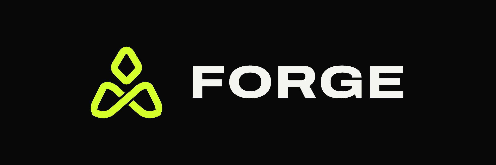

<p align="center">
  
</p>

<p align="center">
  <b>Private, sealed-bid OTC block trades for stock tokens on Robinhood Chain.</b><br>
  <a href="https://forgetrade.sbs">forgetrade.sbs</a> · <code>$FORGE</code>
</p>

---

Forge is a non-custodial OTC desk for large trades. You post a block (token, size, deadline) without showing a price. Answers come back **sealed**, encrypted so only you can open them. You accept one, and an escrow contract settles both sides in **one transaction**. Every fee buys `$FORGE` and burns it.

There are no accounts: no email, no KYC, no sign-up. Access to a block is a private link whose secret lives in the URL `#fragment`, which browsers never send to a server.

> **Status:** pre-launch. The site is live and shows all Robinhood Chain stock-token markets with live DEX prices. Trading opens when the contracts are deployed together with `$FORGE`. The contracts are tested but **not third-party audited**.

## How a block trade works

```
 You (post a block)           Forge API                      Counterparties
   │  post block: token, size,   │                                 │
   │  reply window (no price) ──▶│──── open block ────────────────▶│
   │                             │◀─── sealed answer (ciphertext) ─│  encrypted in the browser,
   │◀── ciphertext ──────────────│     + EIP-712 signature         │  signed by the answerer
   │  decrypt + verify locally   │                                 │
   │  accept the best answer ───▶│──── accepted ──────────────────▶│
   │  buyer: depositPayment(terms) ───── OtcEscrow ◀──────────────── seller: deliver(terms)
   │                                     swap both sides in ONE transaction
   │                                     fee ──▶ BuyBurnVault ──▶ buy $FORGE ──▶ 0x…dEaD
```

## What keeps it honest

| Promise | How the code enforces it |
|---|---|
| **Prices stay private** | Answers are encrypted in the answerer's browser with NaCl box (X25519 + XSalsa20-Poly1305) and a one-time sender key. The server stores ciphertext it cannot open. Your secret key stays in your browser (URL fragment / local storage). Data at rest is also encrypted with XChaCha20-Poly1305, with the column name as associated data. |
| **Nobody controls the escrow** | `OtcEscrow` has no owner, no admin key, no pause and no upgrade. |
| **Terms can't change** | `dealId = keccak256(abi.encode(terms))`. Change one field and it's a different deal. |
| **No counterparty risk** | Payment locks first. The seller's deposit *is* the settlement: both sides swap in one transaction. If the seller misses the deadline, anyone can refund the buyer. |
| **Fees can only burn** | `BuyBurnVault` has no withdraw function. It can only buy `$FORGE` through the active route and send it to `0x…dEaD`. A new route must wait 48 hours in public (`queueRoute` → `activateRoute`). Min-out is checked twice on every burn. |
| **Answers are checked, not trusted** | Your browser verifies every answer before showing it: the EIP-712 signature must recover the sender, and the sender's balance is read on-chain. Signed and funded answers rank first; forged ones are flagged. |
| **Your main wallet stays out** | Ghost mode answers from a one-time wallet. A relayer submits the transaction and pays the gas for a small fee, so nothing on-chain links the trade to your main address. |

## Fees

Charged only when a deal settles, read straight from `OtcEscrow`:

| Deal size (ETH or USDG) | Fee | `$FORGE` holders |
|---|---|---|
| under the tier-1 threshold (~$10k) | 2.5% | 2.0% |
| from tier 1 (~$10k) | 2.0% | 1.5% |
| from tier 2 (~$100k) | 1.5% | 1.0% |
| paid in `$FORGE` | 1.5% flat, and the protocol share is burned in the same transaction | (no extra discount) |

The fee can never exceed `MAX_FEE_BPS` (2.5%). Tier thresholds are fixed at deployment.

## For developers and AI agents

Everything the app does is open to code:

- **REST API** with OpenAPI at `https://api.forgetrade.sbs/openapi.json`, plus an SSE event stream.
- **TypeScript SDK** (`packages/sdk`, served as `/sdk/forge.mjs`):
  ```js
  import { Desk, EscrowClient } from "./forge.mjs";
  const desk = await Desk.connect({ baseUrl: "https://api.forgetrade.sbs" }, "https://forgetrade.sbs");
  const block = await desk.postBlock({ side: "buy", token: TSLA, payToken: USDG, amount: "2500000000000000000000", replyWindow: "1h" });
  const [best] = await desk.readAnswers({ rfqId: block.rfq.id, manageToken: block.manageToken, secretKey: block.secretKey });
  const deal = await desk.accept({ rfqId: block.rfq.id, manageToken: block.manageToken, answer: best, wallet: buyerAddress });
  await new EscrowClient(publicClient, desk.cfg.escrow).depositPayment(buyerWallet, deal.terms);
  ```
- **MCP server** (`packages/mcp`) with 11 tools, so AI agents can trade blocks: `list_markets`, `get_token_info`, `list_open_blocks`, `post_block`, `send_sealed_answer`, `read_sealed_answers`, `accept_answer`, `deposit_payment`, `deposit_tokens`, `refund_deal`, `get_deal_status`. Keys stay in a local keystore. Autopilot is dry-run by default and capped per block and per day.

See [docs/DEVELOPERS.md](docs/DEVELOPERS.md).

## Repository layout

```
contracts/          Foundry: OtcEscrow, BuyBurnVault, UniswapV4BurnRoute (+ tests, deploy scripts)
packages/shared     env validation, error codes, ids / capability tokens, wire schemas, ports, ABIs
packages/crypto     sealed answers (NaCl box), EIP-712 typed data, answer checks, key backup, at-rest encryption
packages/infra      Redis / viem adapters for the ports, plus in-memory twins
packages/sdk        JavaScript SDK (browser + Node), bundled to /sdk/forge.mjs
packages/mcp        MCP server with 11 tools for AI agents
packages/db         Drizzle schema, SQL migrations (integrity guards, optional TimescaleDB)
apps/api            Fastify REST API + SSE stream + OpenAPI (+ lite.ts: single-process build for small servers)
apps/indexer        reorg-safe chain indexer + double-entry mirror ledger
apps/relayer        Ghost-mode relayer (validate, simulate, send, fee-bump)
apps/worker         scheduled jobs: market catalog, DEX prices, notifications
apps/web            Next.js desk: landing, markets, trade, deal rooms, stats, docs, admin
apps/e2e            end-to-end tests on a local anvil chain + the local dev stack
deploy/             production compose stack, and deploy/lite for a single small VPS
docs/               architecture, self-audit notes, services, developer guide
brand/              logos and profile images
```

Node 24+ runs the TypeScript directly (no build step); `tsc` is only the type checker.

## Run it locally

Requirements: Node 24+, and [Foundry](https://book.getfoundry.sh) for the contracts and the local chain.

```bash
npm install
npm run typecheck
npm test                    # every package (Postgres via in-process PGlite)
npm run contracts:test      # Foundry tests
```

Run the whole desk against a local fork of Robinhood Chain mainnet, with the real stock-token markets and DEX prices:

```bash
npm run dev:stack           # anvil fork + contracts + API :8787 + indexer/relayer loops + dev faucet
npm run dev:web             # http://localhost:3000 → "Dev wallet" → "Fund from dev faucet"
```

Backend services with Docker:

```bash
cp .env.example .env        # fill in addresses and RPC URLs
docker compose up -d postgres redis
npm run db:migrate
docker compose up --build
```

## Deploy

- **Full stack** (Postgres/TimescaleDB, Redis, API, worker, indexer, relayer, web, Caddy): [`deploy/docker-compose.prod.yml`](deploy/docker-compose.prod.yml).
- **Lite** (one small VPS, no Docker: embedded Postgres, in-memory cache, Caddy with automatic HTTPS): [`deploy/lite`](deploy/lite/README.md). This is what runs forgetrade.sbs before launch.

## Chain

| | |
|---|---|
| Network | Robinhood Chain mainnet, chain id `4663` |
| RPC | `https://rpc.mainnet.chain.robinhood.com` |
| Explorer | [robinhoodchain.blockscout.com](https://robinhoodchain.blockscout.com) |
| Stablecoin | USDG `0x5fc5360D0400a0Fd4f2af552ADD042D716F1d168` |
| `$FORGE`, OtcEscrow, BuyBurnVault | published here and on [forgetrade.sbs](https://forgetrade.sbs) at launch |

Only trust contract addresses posted on forgetrade.sbs and the official Forge X account.

## Security

- Contracts: 52 Foundry tests, including a TypeScript ↔ Solidity cross-check of the EIP-712 hashing, and Slither in CI. **Not third-party audited.** See [docs/SELF_AUDIT.md](docs/SELF_AUDIT.md).
- Services: 59 service tests, 11 migration tests and 5 end-to-end scenarios on anvil. See [docs/SERVICES.md](docs/SERVICES.md) for what is verified and what is not.
- Found a vulnerability? Please report it privately to the maintainers rather than opening a public issue.

## Docs

- [Architecture](docs/ARCHITECTURE.md)
- [Developers: SDK, API, MCP](docs/DEVELOPERS.md)
- [Services](docs/SERVICES.md)
- [Self-audit](docs/SELF_AUDIT.md)
